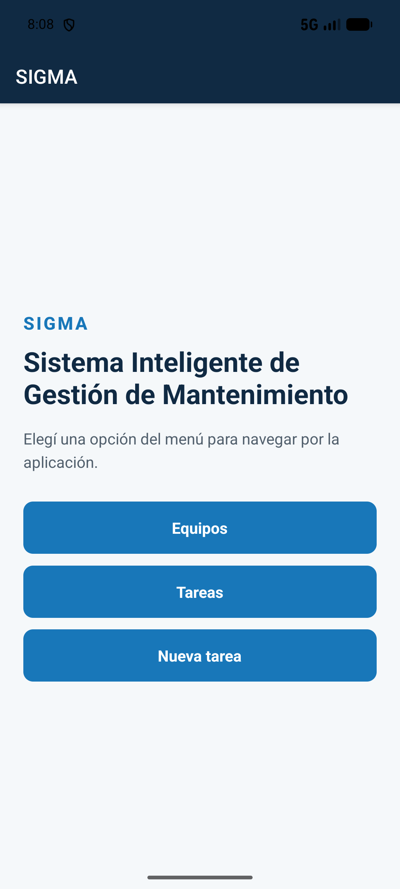
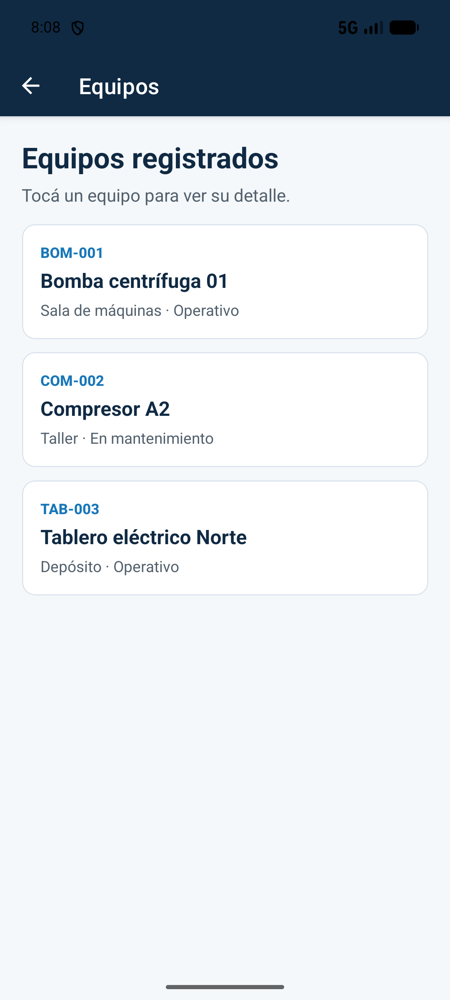
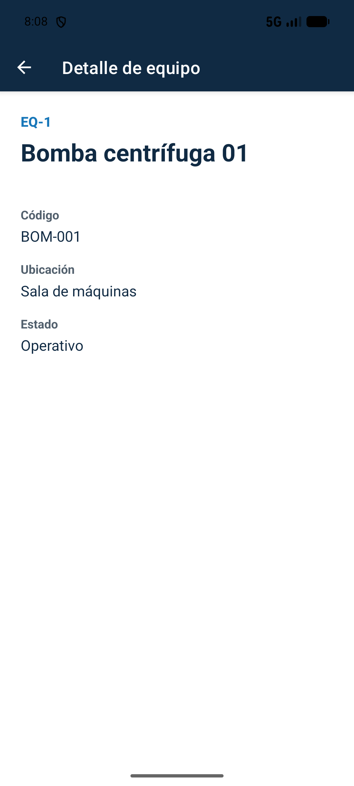
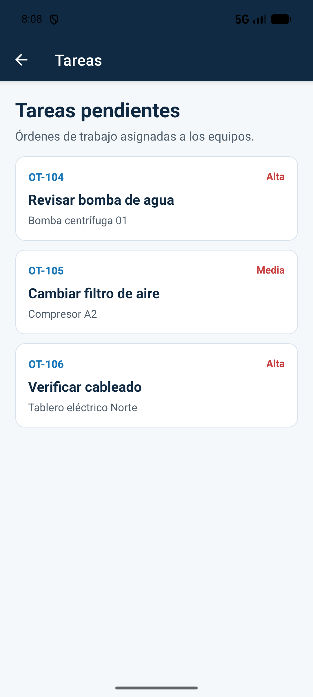
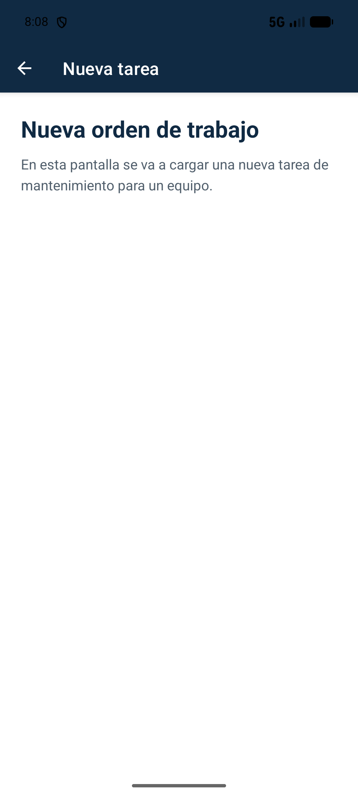

# SIGMA - Navegación con Expo Router

Actividad de la Clase 5 del curso de Desarrollo para Dispositivos Móviles (CTC 2026).

SIGMA (Sistema Inteligente de Gestión de Mantenimiento) es una aplicación móvil hecha con React Native, Expo y TypeScript. En esta actividad se construye su estructura completa de navegación con **Expo Router**: una pantalla de inicio con un menú, los listados de equipos y tareas, y una ruta dinámica para ver el detalle de cada equipo.

El proyecto está preparado para **Expo SDK 57** y se prueba con **Expo Go**.

## Flujo incluido

1. **Inicio** (`app/index.tsx`): menú con los botones **Equipos**, **Tareas** y **Nueva tarea**. Cada botón usa un `Link` para navegar a su pantalla.
2. **Equipos** (`app/equipos.tsx`): `FlatList` con los equipos. Cada tarjeta es un `Link` a la ruta dinámica del equipo.
3. **Detalle de equipo** (`app/equipos/[id].tsx`): ruta dinámica. Lee el parámetro `id` con `useLocalSearchParams` y muestra el código, la ubicación y el estado del equipo.
4. **Tareas** (`app/tareas.tsx`): `FlatList` con las órdenes de trabajo.
5. **Nueva tarea** (`app/nueva-tarea.tsx`): pantalla de carga de una nueva tarea.

Todas las pantallas están declaradas en el `Stack` de `app/_layout.tsx`. El botón de volver del encabezado regresa a la pantalla anterior.

## Estructura del proyecto

```
sigma-navegacion/
├── app/
│   ├── _layout.tsx         // Stack raíz e importación de global.css
│   ├── index.tsx           // Ruta /  (menú de inicio)
│   ├── equipos.tsx         // Ruta /equipos
│   ├── equipos/
│   │   └── [id].tsx        // Ruta dinámica /equipos/[id]
│   ├── tareas.tsx          // Ruta /tareas
│   └── nueva-tarea.tsx     // Ruta /nueva-tarea
├── data/
│   ├── equipment.ts        // Equipos simulados y getEquipmentById
│   └── tasks.ts            // Tareas simuladas
├── types/
│   ├── equipment.ts        // Tipo Equipment
│   └── task.ts             // Tipo Task
├── capturas/               // Capturas de la aplicación funcionando
├── global.css              // Tailwind CSS y tema de NativeWind
├── metro.config.js         // Metro con withNativewind
├── postcss.config.mjs      // Plugin de Tailwind CSS
├── nativewind-env.d.ts     // Tipos para usar className
├── app.json
├── package.json
└── tsconfig.json
```

## Ejecución con Expo SDK 57

Requisitos: Node.js LTS y Expo Go en el celular, o un emulador Android con Expo Go.

Desde la carpeta del proyecto:

```bash
npm install
npx expo start --clear
```

Después se escanea el código QR con Expo Go, o se presiona `a` en la terminal para abrir la aplicación en el emulador Android.

## Instalación de Expo Router y NativeWind

Expo Router se agregó al proyecto en blanco (`blank-typescript`) siguiendo la guía de la clase:

```bash
npx expo install expo-router react-native-safe-area-context react-native-screens expo-linking expo-constants expo-status-bar
```

Luego se cambió `"main"` a `"expo-router/entry"` en `package.json` y se agregaron el `scheme` y el plugin `expo-router` en `app.json`.

NativeWind v5 se instaló con la guía para Expo SDK 57:

```bash
npm install --save-exact nativewind@5.0.0-rc.0 react-native-css@3.1.0-rc.0
npx expo install react-native-reanimated react-native-worklets react-native-safe-area-context expo-system-ui
npm install --save-dev --save-exact tailwindcss@4.1.12 @tailwindcss/postcss@4.1.12 postcss lightningcss@1.30.1
```

NativeWind queda instalado y configurado (`global.css`, `postcss.config.mjs`, `metro.config.js` y `nativewind-env.d.ts`), pero las pantallas de esta actividad usan `StyleSheet`.

## Conceptos que muestra

- Expo Router: cada archivo dentro de `app/` es una pantalla.
- `Stack` con títulos en el encabezado y botón de volver.
- `Link` con `asChild` para que un `Pressable` funcione como enlace.
- Ruta dinámica con `[id].tsx` y lectura del parámetro con `useLocalSearchParams`.
- Datos y tipos en archivos separados.
- `FlatList` y estilos con `StyleSheet`.

## Capturas

| Inicio | Equipos | Detalle de equipo |
|:---:|:---:|:---:|
|  |  |  |

| Tareas | Nueva tarea |
|:---:|:---:|
|  |  |

Recorrido de las capturas, en un emulador Android con Expo Go: Inicio → **Equipos** → tocar *Bomba centrífuga 01* abre `/equipos/eq-1` → volver al inicio → **Tareas** → volver al inicio → **Nueva tarea**.

## Verificación

- Cada botón del menú abre su pantalla: Equipos, Tareas y Nueva tarea.
- Al tocar un equipo se abre su detalle mediante la ruta dinámica `/equipos/[id]`, con los datos del equipo elegido.
- El botón de volver del encabezado regresa a la pantalla anterior.
